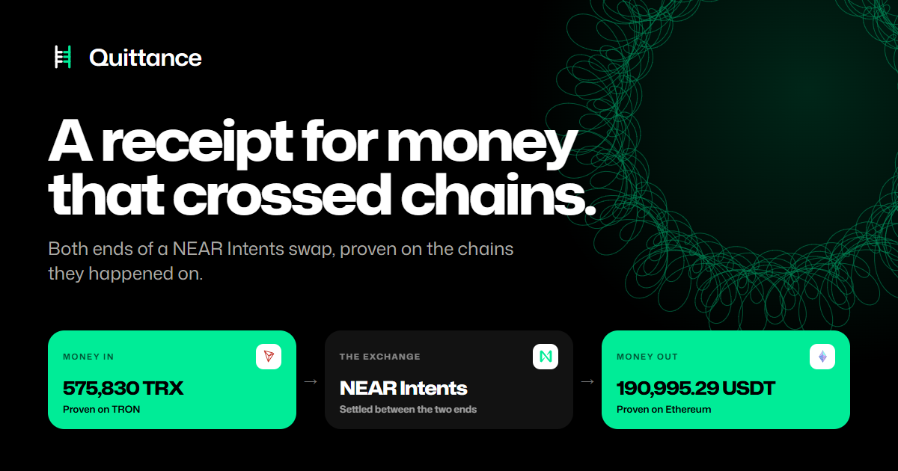

# Quittance

[](https://github.com/AustinChris1/quittance/actions/workflows/ci.yml)



**A receipt for money that crossed chains.** When a NEAR Intents swap says `FAILED`, or says
`SUCCESS` and nothing seems to arrive, the status word is all anyone has. Quittance replaces it with
evidence.

Paste a transaction hash from any chain the swap touched, the deposit address its quote issued, or
the wallet that sent or received it. Quittance reads public records only, proves the deposit and the
payout on the chains they happened on, and returns one of eight labels with the facts it observed,
the limits of what it can see, and the next step. It holds no keys, moves no funds, and opens no
support tickets.

A quittance is an old legal word for a written receipt proving an obligation has been discharged.

- **Try it:** https://quittance-five.vercel.app
- **Docs:** https://quittance-five.vercel.app/docs
- **Submission summary, one page:** [docs/SUBMISSION.md](docs/SUBMISSION.md)
- **Check it in a minute, no install or keys:** `node apps/cli/src/main.ts verify`, then [Run it](#run-it)

## What it found on its first real case

A stuck deposit reported on the NEAR forum, 575,830 TRX or roughly 193,000 dollars said to be lost,
had already been delivered when the complaint was filed.

| When | What | Verified against |
| --- | --- | --- |
| 2026-09-11 16:25:57Z | 575,830 TRX reached the deposit address `TBy2io...2sus` | TRON block 86,157,305 |
| 2026-09-11 16:27:04Z | 575,830 TRX credited to `intents.near` | NEAR chain |
| 2026-09-27 11:16:35Z | 190,995.293894 USDT delivered to `0x632f...8bad` | Ethereum block 26,068,435 |
| 2026-10-09 | Forum post: FAILED since 12 Sep, zero refund, no reply | gov.near.org thread 42664 |

Settlement took about 16 days, 15 days and 19 hours from deposit to delivery. The public report of
a loss was filed 12 days after the money arrived, and the thread is still open and unanswered. The
poster cited `refundedAmount: 0` as proof they got nothing back, when on a settled swap that field
is correctly zero because no refund was due. A healthy field read as a symptom.

Both ends were read on their own chains, not taken from the operator's record: the deposit from a
TRON node, the payout from an Ethereum node. The amount reconciles too. The quote promised
191,757.901149 USDT with a guaranteed minimum of 189,840.322137 at 1 percent slippage, and
190,995.293894 arrived, 0.40 percent under the quote and inside its guarantee. That is the whole
thesis: a status word is not an answer, in either direction.

## Why the two ends matter now

On 27 October 2026, NEAR's [changelog](https://docs.near-intents.org/changelog/overview) says
1Click swaps roll out as confidential only. The exchange settles on the NEAR Private Shard, and
`nearTxHashes` lists only the public shield and unshield. So the status word now describes a step
no public record can reach. What stays public is the deposit on the origin chain and the payout on
the destination chain, and those are exactly what Quittance proves. The receipt names the private
middle for what it is and never paints it as proven.

## How much of real traffic it can prove

Measured on 2026-10-28 over the 1,000 most recent successful swaps, with
`node apps/cli/src/main.ts coverage --check 100 --save`. The snapshot is
[`studies/coverage-2026-10-28.json`](studies/coverage-2026-10-28.json).

| Measure | Result |
| --- | --- |
| External payouts on a chain Quittance reads | **81.8%** of payouts, 82.8% of quoted value |
| The same for an ERC20-only reader, before this version | 27.0% of payouts, 36.8% of value |
| Payouts actually proven on their own chain, of 100 checked | **99**, one inconclusive, none contradicted |
| Payouts to shielded Zcash addresses, unprovable by anyone | 7 |
| How the last 1,000 swaps of any status ended | 965 SUCCESS, 24 REFUNDED, 9 PROCESSING, 2 FAILED |

The inconclusive one is a native coin paid inside a contract call, which public endpoints cannot
show without a trace. Chains not yet read independently are listed in the snapshot; for them the
receipt says delivery rests on the operator's record.

How it was measured, so it can be audited:

- **Sample.** The 1,000 most recent `SUCCESS` swaps the Explorer API returned at the time of
  measurement, newest first. The snapshot records the window: 11:15 to 12:45 UTC on 28 October.
- **Denominator.** Of those, the 978 whose `recipientType` is `DESTINATION_CHAIN`, meaning the
  payout left NEAR for another chain. Payouts that stay inside NEAR Intents are excluded.
- **Readable.** The destination asset's chain, taken from the public 1Click token list, is one
  Quittance has a reader for. Payouts to NEAR accounts are not yet counted as readable.
- **Proven.** 100 readable payouts, spread evenly across the window by position rather than chosen.
  Proven means the destination transaction was read on its own chain, its receipt succeeded, and
  the quoted asset moved to the quoted recipient. Inconclusive, contradicted and unread are counted
  separately and never as proven.
- **Value.** Shares by value use the quoted USD at creation, not a realised amount.
- **Limits.** One window at one moment. A sample of 100 shows the readers work on real traffic; it
  does not prove every payout on every chain.


## How big the problem is

Most swaps settle. The finding is the tail. Run `node apps/cli/src/main.ts study --save` to
reproduce it.

Measured 2026-10-26:

| Cohort | Sampled | Deposit landed | Landed, never settled, never refunded | Notional | Median age |
| --- | --- | --- | --- | --- | --- |
| `FAILED` | 1000 (capped) | 145 | 29 | $1,959 | 27 days |
| `PROCESSING` | 310 (full) | 283 | **44** | **$334,054** | **255 days** |

Most `FAILED` records never received a deposit at all; they are abandoned quotes, which is why the
classifier refuses to say `STRANDED` without a landed deposit. Forty-four swaps took a deposit,
produced no destination transaction and charged no refund fee, and have sat that way for a median
of 255 days. The largest single one is $114,620 of quoted notional. Those are not pending; they are
forgotten. And the people holding them cannot look them up, for the reason further down.

Notional is the quoted USD value at creation, not a realised loss, and some may yet settle, as the
case above did after sixteen days. Snapshots retain counts only: no addresses, no per-user
amounts, no identifiers.

## Run it

No install. The core has zero runtime dependencies and Node runs the TypeScript directly.
Requires Node 24 or newer (`node --version`).

**Step 1 - classify every frozen case and check the labels.**

```
node apps/cli/src/main.ts verify
```

Expect `labels correct 17 of 17` and a median classify time under a millisecond.

**Step 2 - print the receipt for the case above.**

```
node apps/cli/src/main.ts replay 01-reported-stranded-actually-delivered
```

Expect `LABEL DELIVERED`, a `deposit_proof` row for 575,830 TRX on TRON, and the published
destination transaction, against a forum thread that still says the money is gone.

**Step 3 - read live from mainnet, with no key of any kind.**

```
node apps/cli/src/main.ts check --deposit TBy2io3Q3Jt4UM4ejDhkkUQJZgZuXw2sus
node apps/cli/src/main.ts check --deposit 0xDF7A93d400159d0f8f40AAe42576d01285EA9e39 --json
```

The first is the deposit address of the $193K swap. The status endpoint answers without a key,
and Quittance reads both ends on their own chains. The receipt opens with one plain sentence:
*Delivered on Ethereum about 16 days after the deposit. Both ends proven on their own chains: the
deposit on TRON, the delivery on Ethereum.*

The second uses an address the operator has never seen, on purpose. It calls the status endpoint
with no credentials at all, and the receipt cites `HTTP 404 unauthenticated, limit 1200`, which is
the server confirming it processed an anonymous lookup.

**Step 3b - search by any transaction or wallet, if you have a partner JWT in `.env`.**

```
node apps/cli/src/main.ts check --search 0x9be9c2f8ed78d32ecf222bca3595d50cc42aed979030e4ebf0f84a626e13421a
node apps/cli/src/main.ts check --search 0x632F5D32448DE43b8b9cfD063aCfcDac09108bad
```

The first is the Ethereum payout of the same swap: any transaction from either end resolves to it.
The second is the wallet that was paid. A wallet appears in many swaps, so Quittance does not guess
one. It lists the swaps the wallet sent, received or was refunded in, and each can be checked next.
Search is the one thing a partner token genuinely unlocks.

**Step 3c - a confidential swap, which no public index can see.**

```
node apps/cli/src/main.ts check --search 3djtQ3pUHv8SGtNKS3CMGice7E7S9oeS4DJzNYyjCUVD
```

Expect `SHIELDED_UNPROVEN`. This is one of the two swaps reported in
[near/intents#384](https://github.com/near/intents/issues/384) as a misroute. Neither the status
endpoint nor the Explorer has any record of it. The only public trace is a successful
`execute_intents` call that emits no ordinary token events, so Quittance decodes the signed NEP-413
intent inside it: 0.038 ETH on Robinhood Chain, transferred to the documented Confidential Intents
treasury. That is the shield step, and it has no public out. The receipt says so, and says just as
plainly that public records can prove neither delivery nor loss from there. It names only the
lookups it actually made.

"Private" has a precise meaning here, and the receipt states it. NEAR's
[Confidential Intents documentation](https://docs.near-intents.org/integration/market-makers/confidential-intents)
describes FAR as a permissioned instance of the NEAR protocol run by a small validator set, with a
private RPC. So the balances are hidden from public indexers, not from those validators.

**Step 4 - close the loop into an endpoint you control.**

In one terminal:

```
QUITTANCE_WEBHOOK_SECRET=demo-secret node apps/sink/src/main.ts
```

In another:

```
node apps/cli/src/main.ts replay 10-stranded-synthetic --webhook http://localhost:8787/receipts --secret demo-secret
```

The sink prints `received STRANDED rule=stranded/terminal-with-no-refund` and files it under a
ticket reference derived from the fingerprint. Repeat with `--secret wrong-secret` and the sink
answers HTTP 401, because the body is signed with HMAC SHA256.

**Step 5 - run the interface.**

```
pnpm install
pnpm -C apps/web build && pnpm -C apps/web start
```

Open http://localhost:3000 for the story, http://localhost:3000/docs for the documentation, or go
straight to a resolved result at
http://localhost:3000/check?q=TBy2io3Q3Jt4UM4ejDhkkUQJZgZuXw2sus

The partner token is read server side and never reaches the browser. Without one the interface
still runs; it reports what it could not resolve instead of guessing.

**Step 6 - see the rules and measure the rails.**

```
node apps/cli/src/main.ts rules
node --test packages/core/test/fixtures.test.ts
node apps/cli/src/main.ts coverage --save
```

**Step 7 - check that a saved receipt was not altered.**

```
node apps/cli/src/main.ts replay 01-reported-stranded-actually-delivered --json > receipt.json
node apps/cli/src/main.ts receipt receipt.json
```

Expect `CONSISTENT` and the two explorer links, TRON and Ethereum, to check by hand. Edit any value
in the file and run it again: it reports `INCONSISTENT`. The checker's **Download JSON** button saves
the same file.

Be precise about what that shows. Whoever edits a receipt can also recompute the fingerprint inside
it, so a consistent file is not by itself tamper-proof. To detect tampering, compare against a
fingerprint obtained separately, for example the one on the checker's page or in a support ticket:

```
node apps/cli/src/main.ts receipt receipt.json --expect <fingerprint>
```

That reports `MATCHES` or `MISMATCH`. Either way the fingerprint covers the file, not the truth of its
claims; the explorer links are how anyone checks those against the chains.

## Watch a swap

A swap that is still moving, or shielded, can be watched. On its receipt, **Watch** asks for
notification permission, and Quittance alerts you once when the evidence changes: for example
`IN FLIGHT is now DELIVERED`, with the new one-line summary and a link back to the receipt. The
forum case above would have been answered the day the payout landed, not twelve days later.

How it stays honest:

- **The server rechecks, the browser only displays.** A phone cannot keep polling TRON and
  Ethereum in the background. Every 15 minutes a scheduled job calls `/api/watch/run`, which runs
  the same check the page runs. The service worker only shows what it is sent.
- **One alert per change.** It keys on the evidence and the verdict, not on when they were read,
  so a recheck that finds nothing new sends nothing. A test asserts both halves.
- **It stops.** A proven delivery or a refund ends the watch. Otherwise it ends at the period you
  chose, 3 to 30 days. A subscription the browser has dropped is pruned, not retried.
- **One lookup per swap.** Everyone watching the same swap shares one recheck, so a popular swap
  does not multiply calls against the Explorer's rate limit.
- **No account.** The push subscription is the identity. The watch list lives on the server in a
  private store, never in a public file.

It installs as an app too. iPhones and iPads only deliver web notifications to apps on the Home
Screen, so the panel says so there; Chrome and Edge offer **Install app** directly. **Send a test**
shows what an alert looks like before anything changes.

## Where it proves a transfer

| Chain | Read |
| --- | --- |
| Ethereum, Base, Arbitrum, Optimism, Polygon, BNB Chain, Gnosis, Avalanche, Robinhood Chain | Transfer logs for tokens, transaction value for the native coin |
| TRON | TRC20 Transfer logs, and TRX transfers |
| Solana | Token balance changes by mint and owner, and lamport changes for SOL |
| NEAR | Credits to `intents.near`, and transfers inside signed intents |

"Proven" has a precise meaning. Quittance reads the transaction from the chain's public RPC
endpoints, several per chain, and checks that its receipt succeeded and that the quoted asset moved
to the quoted address. That is independent evidence, read from the chain rather than from the
operator. It is not a trustless cryptographic proof: nothing is checked against chain state with a
light client, which is why every proof also carries an explorer link anyone can open.

Each asset's chain, contract and decimals come from the public 1Click token list, so nothing is
guessed from an asset id. A chain that answers and does not show the transfer is a contradiction.
A read that fails on every endpoint is unread. A native coin paid inside a contract call is
inconclusive. Only the first can change a verdict.

## What a partner key is for, and what the real barrier is

Measured against the live server on 2026-10-26:

| Call | Result |
| --- | --- |
| No `X-API-Key` | `404 Deposit address ... not found`, with `X-RateLimit-Limit-unauth: 1200` |
| A deliberately wrong `X-API-Key` | `401` |

So reading a swap needs no key, and a rejected key is worse than no key. Quittance retries
unauthenticated when a supplied key returns 401, and records which tier the server applied in the
receipt's `sources`. A partner key governs the quote fee schedule, where unauthenticated quotes
carry an extra 0.25 percent platform fee. It is not a gate on reading.

The real barrier is the shape of the lookup. `/v0/status` accepts a deposit address plus an
optional memo, and nothing else. There is no correlation-id parameter, and there could not usefully
be one: the correlation id is a per-request trace, not a swap identifier. Three consecutive calls
for the same swap returned `7ff00f92-...`, `b9784595-...` and `98b41cc8-...`. The specification
says as much, describing it as a "unique identifier for request tracing and debugging".

So when a support thread quotes a correlation id as the handle for a stuck swap, which is exactly
what the case above does, it is quoting the id of one HTTP request made weeks earlier. Nobody can
resolve it, including the operator. That is why Quittance accepts any transaction, deposit address
or wallet, and resolves through the Explorer.

## The labels

| Label | Meaning |
| --- | --- |
| `STRANDED` | Deposit arrived, swap is terminal, nothing came back. |
| `WRONG_DOOR` | Deposit does not match the quote it was made for, wrong chain or wrong asset. |
| `LOCKED_OUT` | A refund exists on paper but the connector timelock puts it out of reach. |
| `SHIELDED_UNPROVEN` | The route is private. Public records cannot prove delivery either way. |
| `DELIVERED` | A destination transaction is published, and read from the destination chain where it can be. |
| `REFUNDED_OK` | The money went back to the refund address. |
| `IN_FLIGHT` | Not terminal yet. |
| `UNDETERMINED` | Not enough evidence, or the chain contradicts the record. Never a clean bill of health. |

Rules are evaluated in a fixed order and the first match wins. Every verdict carries a `basis`
(facts observed), `limits` (what it cannot see) and a `next` action. No verdict is produced
without limits.

`SHIELDED_UNPROVEN` is deliberately cautious. On a confidential route the treasury holding the
tokens while the public balance reads zero is documented behaviour, so Quittance reports that
delivery cannot be verified from public data rather than claiming a loss. A test enforces this.

## What it will not do

- Hold keys or funds. Every read is read-only.
- Send a transaction. The one write is posting a receipt to a webhook the operator controls.
- File support tickets for strangers. It produces the attachment; a human decides to send it.
- Claim recovered money. No dollar figure for funds rescued appears anywhere.
- Accuse anyone. Each label states its evidence and the edge of that evidence.

## Evidence

Each fixture carries its own provenance block. Three of the cases were open and unanswered in
`near/intents` when they were recorded.

| Case | Source |
| --- | --- |
| `01-reported-stranded-actually-delivered` | [Forum thread 42664](https://gov.near.org/t/failed-near-intents-1-click-swap-575-830-trx-193k-stuck-failed-status-zero-refund-no-support-response/42664), the [NEAR deposit](https://nearblocks.io/txns/8a33DkKfZMWRKbK2pXuQAWVLXSy4AyZF6PfcENvCJgCb) and the [Ethereum delivery](https://etherscan.io/tx/0x9be9c2f8ed78d32ecf222bca3595d50cc42aed979030e4ebf0f84a626e13421a) |
| `02-wrong-door-base-eth` | [near/intents#382](https://github.com/near/intents/issues/382) |
| `03-locked-out-btc` | [near/intents#385](https://github.com/near/intents/issues/385) |
| `04-shielded-unproven` | [near/intents#384](https://github.com/near/intents/issues/384) |
| `05`, `06`, `08`, `09` | Controls and regression guards, so the rules are shown not to label every swap a failure |
| `10-stranded-synthetic` | Synthetic. We hold no verified real STRANDED case, and say so rather than implying one |
| `11`, `12` | The two confidential swaps in [near/intents#384](https://github.com/near/intents/issues/384), read from their signed intents: [0.038 ETH](https://nearblocks.io/txns/3djtQ3pUHv8SGtNKS3CMGice7E7S9oeS4DJzNYyjCUVD) and [0.001 ETH](https://nearblocks.io/txns/jNeJZQ4pa4p69LBiEvTDbTj2WmhCgiKRY2a2scA193j) |
| `13-shield-then-delivered` | Regression guard. A proven delivery beats a shield step, so the treasury rule never hides an arrival |
| `14-success-contradicted-by-chain` | Regression guard. A SUCCESS whose published destination transaction pays someone else reads `UNDETERMINED`, never `DELIVERED` |
| `15-success-chain-unreachable` | Regression guard. When the destination chain cannot be reached, `DELIVERED` rests on the operator record and the receipt says so |
| `16-both-ends-proven-after-confidential-switch` | Read live on 2026-10-28, the day after the switch: 150 USDC in on [Base](https://basescan.org/tx/0x3bc28ac85aeed821c5398415c9d968e5039ac43dd40acb66346d7691187440c5), 149.829629 USDT out on [Solana](https://solscan.io/tx/btNXANHfxCauYsocKsnXYcjhPnxn6HXoX2ceSAGtsfqbyo4PK9Ck4Pifs1cmCze6vqKpQc5PhwZJspnu8kxCXPA) |
| `17-payout-inside-contract-call` | Regression guard. A payout the chain cannot show is inconclusive, never a contradiction |

On case 01 the chain was the better witness, and it overturned the report. The deposit confirms on
TRON at 2026-09-11T16:25:57Z and is credited on NEAR at 16:27:04Z, one day earlier than the forum
post states, and the Ethereum delivery lands on 2026-09-27. The fixture records the correction,
not the claim, and its provenance block carries the full timeline.

## Layout

```
packages/core/src/classify.ts     ordered rules, first match wins
packages/core/src/gather.ts       resolves the swap and assembles evidence
packages/core/src/receipt.ts      canonical JSON, sha256 fingerprint, text rendering
packages/core/src/sources/        1Click status and tokens, Explorer, NearBlocks, NEAR RPC,
                                  EVM, TRON, Solana
packages/core/src/webhook.ts      the only write, HMAC signed
packages/core/src/coverage.ts     how many real payouts can be proven
packages/core/src/watch.ts        what a watcher compares between two checks
packages/core/src/study.ts        the stuck tail, aggregates only
apps/cli/src/main.ts              check, replay, cases, verify, rules, study, coverage, receipt
apps/sink/src/main.ts             reference receiver, stands in for an integrator endpoint
apps/web                          landing page, the checker, the docs and the API
studies/                          dated measurement snapshots
fixtures/                         frozen cases with provenance
```

Receipts are fingerprinted with a sha256 over canonical JSON, so two runs over the same evidence
produce the same fingerprint and any change to the evidence changes it.

## Development timeline

The rules on nearhackathon.com say "Code written since the announcement counts".

| Date | Event |
| --- | --- |
| 19 October 2026 | The hackathon is announced. |
| 26 October 2026 | First commit. Everything in this repository was written from this date on. |
| 1 to 14 November 2026 | The submission window. |

The commit history carries the rest, one working step per commit.

## Brand

The mark is a split tally: a debt notched across a stick, split so each party held half, proven
discharged when the halves matched, which is how Quittance matches a swap's deposit to its
delivery. The kit, with marks, icons, lockups, the social card, the X banner and the launch
thread's images, is in [`brand/`](brand/README.md), and `node brand/build.mjs` rebuilds all of it.

## Built for

NEAR Hackathon, 1 to 14 November 2026. Tracks: Unstoppable DeFi, Real-World Money, Privacy and
Private AI, Open Innovation.
