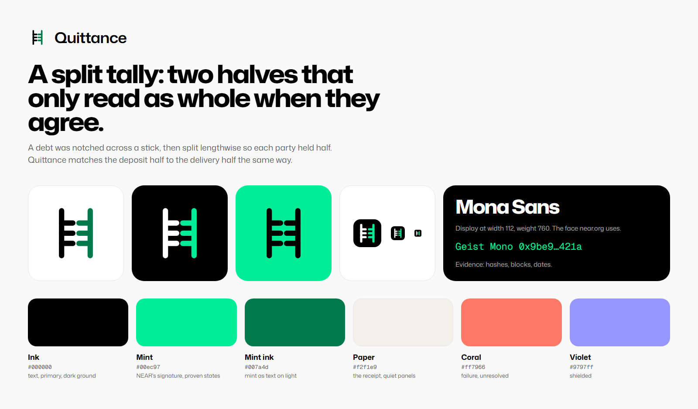

# Quittance brand kit



## The mark

A split tally. A debt was notched across a stick, then split lengthwise so each party held half;
matching the halves proved the obligation was discharged. Quittance matches the deposit half of a
swap to the delivery half the same way, so the notches only read as whole when they agree.

It is eight round-capped strokes on a 32 unit grid, with no fill, texture or font, so it holds at
16px and recolours with the palette.

## Files

| Use | File |
| --- | --- |
| Mark on a light ground | `mark-on-light.svg`, `mark-on-light-1024.png` |
| Mark on a dark ground | `mark-on-dark.svg`, `mark-on-dark-1024.png` |
| One colour | `mark-mono-black.svg`, `mark-mono-white.svg` |
| Mark with the wordmark | `lockup-on-light.png`, `lockup-on-dark.png` (2280 x 600, transparent) |
| App icon and favicon | `app-icon.svg`, `app-icon-16.png` to `app-icon-1024.png` |
| App icon on a dark ground | `app-icon-mint.svg` |
| X or GitHub avatar | `avatar-400.png` (circle safe) |
| X header | `x-banner-1500x500.png` (clear of the profile photo at lower left) |
| Link preview | `social-card-1200x630.png`, served by the site as `/og.png` |
| Launch thread on X | `thread/1-…png` to `thread/4-…png` (3200 x 1800, 16:9), one per post |
| The guilloché motif | `guilloche-mint.svg` |

## Colour

| Token | Hex | Use |
| --- | --- | --- |
| Ink | `#000000` | text, primary buttons, the dark ground |
| White | `#ffffff` | text and the mark on dark |
| Mint | `#00ec97` | NEAR's signature: proven states, the accent half of the mark on dark |
| Mint ink | `#007a4d` | mint as text or as the mark's accent on light, where raw mint fails contrast |
| Paper | `#f2f1e9` | the receipt, quiet panels |
| Coral | `#ff7966` | failure and unresolved states only |
| Violet | `#9797ff` | shielded states only |

## Type

- **Mona Sans**, the face near.org uses. The wordmark is weight 600 at width 108. Display runs at
  width 112, weight 760, with tight tracking.
- **Geist Mono** for evidence: hashes, block numbers, dates.

## Do not

- Redraw, stretch, outline or add effects to the mark.
- Put raw mint on a white ground for text or the mark; use mint ink.
- Use coral or violet as decoration. They carry meaning in the product.
- Put lines, hatching or texture behind content.

## Regenerate

The SVGs are written from the mark's geometry; the PNGs are rendered with the real fonts.

```
chrome --headless=new --remote-debugging-port=9555 --user-data-dir=%TEMP%\qbrand
node brand/build.mjs
```
