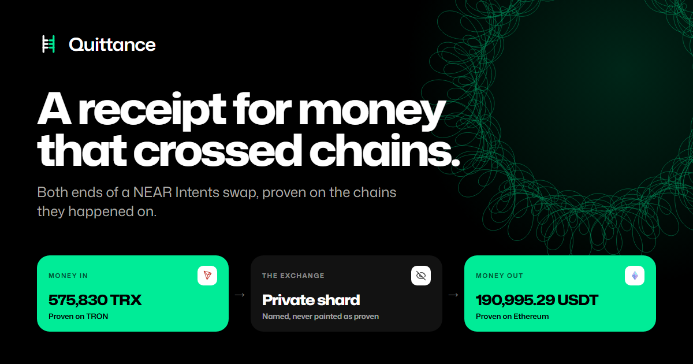

# Quittance: NEAR Hackathon submission

**A receipt for money that crossed chains.** Paste any transaction hash, deposit address or wallet
from a NEAR Intents swap. Quittance proves the deposit and the payout on the chains they happened
on, and says plainly what public records cannot show.

| | |
| --- | --- |
| Live | https://quittance-five.vercel.app |
| Repository | https://github.com/AustinChris1/quittance |
| Docs | https://quittance-five.vercel.app/docs |
| Demo | The 60 second film in the launch post on X, linked in the submission form |
| Tracks | Open Innovation, Unstoppable DeFi, Privacy and Private AI, Real-World Money |
| Built | 26 October to 1 November 2026, every line after the hackathon was announced |



## The problem

A NEAR Intents swap shows its user a status word: `PROCESSING`, `FAILED`, `SUCCESS`. When money
seems stuck, that word is all anyone has, and nobody can look the swap up. The status endpoint
is keyed only by deposit address. The correlation id that support threads quote identifies one HTTP
request, not the swap; three calls for one swap returned three different ids.

Since 27 October, 1Click swaps settle on the NEAR Private Shard, so the status word now
describes a step no public record can reach.

## What Quittance does

1. Resolves any identifier: a transaction from either chain, the deposit address, or a wallet. A
   wallet lists its swaps instead of guessing one.
2. Reads the deposit on the origin chain and the payout on the destination chain, from each
   chain's own public nodes: nine EVM chains (Ethereum, Base, Arbitrum, Optimism, Polygon, BNB Chain,
   Gnosis, Avalanche, Robinhood Chain), TRON, Solana and NEAR.
3. Reconciles what arrived against the quote and its guaranteed minimum.
4. Returns one of eight labels. Each receipt carries what was observed, the limits of what can be
   seen, and the next step, and is fingerprinted with sha256 over canonical JSON.
5. Watches a swap and sends a browser alert once, when its evidence changes.
6. Sells the same receipt to agents for one x402 payment of $0.01 in USDC on NEAR mainnet, or on
   Base, with no account or key. The site stays free; a failed lookup is never charged.

## What it found

- **The $193K case was not lost.** A forum post on 9 October reported 575,830 TRX as failed with
  zero refund. Quittance proved the deposit on TRON and 190,995.293894 USDT delivered to the
  quoted recipient on Ethereum on 27 September, 12 days before the post. That is 0.40% under the
  quote and inside its guarantee.
- **The tail is real.** On 26 October, 44 swaps had taken a deposit, sent nothing on and charged no
  refund, at a median age of 255 days, holding about $334,000 of quoted notional. That is the
  quoted value, not a realised loss.
- **It works on real traffic.** On 28 October, 81.8% of external payouts in the last 1,000 swaps
  were on a chain Quittance reads, and 99 of 100 sampled payouts were proven on their own chain,
  with none contradicted.

## Check it yourself in a minute

Node 24 or newer, no install, no keys:

```
node apps/cli/src/main.ts verify
node apps/cli/src/main.ts check --deposit TBy2io3Q3Jt4UM4ejDhkkUQJZgZuXw2sus
```

The first re-classifies all 17 frozen cases and prints `labels correct 17 of 17`. The second
reads the $193K swap live from mainnet and proves both ends. The [README](../README.md) walks
through every other command.

## What it will not do

It holds no funds, never asks for anyone's keys, files nothing on anyone's behalf, and claims no
recovered money. On the paid door, fees move straight from the payer to the payee.
On a private route it proves the shield and says that delivery and loss cannot be proven from
public data. "Proven" means read from the chain's public RPC endpoints with an explorer link to
check, not a light-client proof, and the receipt says so.
